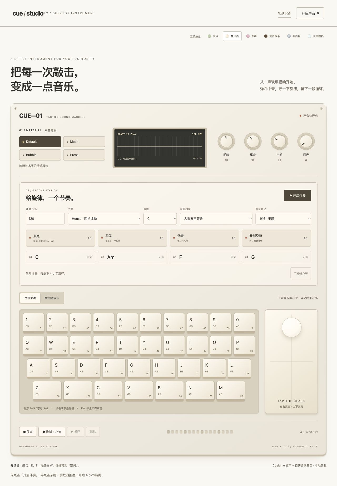

# CUE Studio · 指尖声音实验室

一台运行在浏览器里的互动音乐合成器，支持电脑键盘、手机打击垫、文字输入与玻璃触控演奏。

- 36 键演奏、四种声音材质、六种外观主题。
- House / Lo-fi / Pop 鼓点，和弦与低音伴奏，分轨静音。
- 12 个调，五声音阶、大调、小调与自由半音阶。
- 四拍倒数、四小节录制、1/8 或 1/16 量化和自动循环。

在线体验：[CUE Studio](https://cue-studio-ten.vercel.app/)

## 本地使用

在此文件夹打开终端：

```sh
git clone https://github.com/zhuningli001/cue-studio.git
cd cue-studio
npm ci
npm run dev
```

需要 Node.js 与 npm。依赖及构建产物不会提交到仓库。

- `npm test`：运行乐理与量化测试。
- `npm run build`：生成 dist/ 发布文件。
- PC 入口：`http://127.0.0.1:5173/?device=pc`
- MOB 入口：`http://127.0.0.1:5173/?device=mob`

## 文件说明

| 路径 | 内容 |
| --- | --- |
| src/ | 合成器、伴奏、量化录制、设备交互与主题样式 |
| public/ | 图标与第三方许可证 |
| tests/ | 音阶、和弦与量化测试 |
| index.html | 网页入口 |
| package.json、package-lock.json | 项目命令与依赖版本 |
| Demo.md | 功能约定、验证记录与部署信息 |
| preview*.png、cue-groove-release.png | 历次界面预览 |
| dist/ | 当前构建产物，可重新生成 |
| node_modules/ | 本地依赖，可通过 npm ci 重新安装 |

技术栈：Vite、原生 JavaScript、Tone.js、Cuelume。演奏与输入在浏览器本地处理；仅保存外观选择，刷新页面会清空录音。



功能与验证记录见 [Demo.md](Demo.md)。第三方许可证见 [public/third-party-licenses.txt](public/third-party-licenses.txt)。
